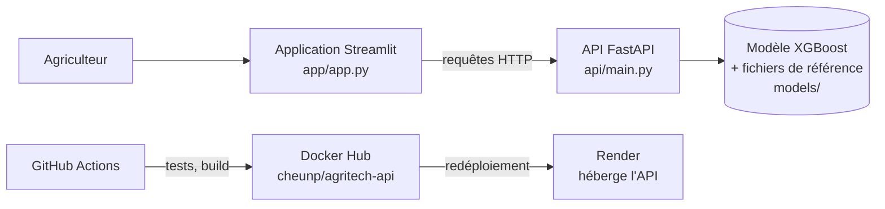

# 🌾 Agritech Answers — Prédiction de rendement et recommandation de cultures

[](https://github.com/Tcheunzy/Agriculture_recommandation_-_prediction_system/actions/workflows/ci-cd.yml)
[](https://hub.docker.com/r/cheunp/agritech-api)
[](https://hub.docker.com/r/cheunp/agritech-api)


Application web d'aide à la décision pour les agriculteurs, réalisée dans le cadre du projet 12 du parcours Data Scientist / ML Engineer d'OpenClassrooms.

Elle propose deux fonctions complémentaires :

- **Prédiction** : estimer le rendement (t/ha) d'une culture dans un pays, selon les conditions (température, niveau d'usage de pesticides, année).
- **Recommandation** : simuler le rendement de toutes les cultures pour les mêmes conditions et les classer — par **revenu estimé** si l'agriculteur saisit ses prix de vente, sinon par **rendement relatif** (rendement estimé comparé au rendement moyen de la culture).

## 🔗 Liens

| Service | Adresse |
|---|---|
| Application Streamlit | https://tcheunzy-agriculture-recommandation---prediction--appapp-yxdwop.streamlit.app/ |
| API (documentation interactive) | https://agritech-api-hcep.onrender.com/docs#/default/recommend_recommend_post|
| Image Docker | [cheunp/agritech-api](https://hub.docker.com/r/cheunp/agritech-api) |

> L'API est hébergée sur l'offre gratuite de Render : après une période d'inactivité, la première requête peut prendre une trentaine de secondes.

---

## 🏗️ Architecture



- **Front-end** : Streamlit. L'interface ne contient aucune logique de Machine Learning : elle interroge uniquement l'API.
- **Back-end** : API FastAPI conteneurisée avec Docker, qui charge le modèle et les fichiers de référence au démarrage.
- **Modèle** : pipeline scikit-learn (prétraitement + XGBoost) sauvegardé avec joblib.
- **Suivi des expériences** : MLflow.
- **CI/CD** : GitHub Actions (tests → build → publication sur Docker Hub → redéploiement sur Render).

## 📁 Structure du dépôt

```
├── .github/workflows/ci-cd.yml   # pipeline CI/CD
├── api/
│   ├── main.py                   # application FastAPI (endpoints)
│   ├── schemas.py                # schémas Pydantic des requêtes et réponses
│   └── requirements.txt          # dépendances de l'API (image Docker)
├── app/
│   ├── app.py                    # interface Streamlit
│   └── requirements.txt          # dépendances de l'interface
├── src/
│   ├── features.py               # calcul des variables, partagé entraînement / API
│   └── recommandation.py         # prédiction, rendement relatif, revenu, classement
├── models/
│   ├── modele_xgboost.joblib     # modèle entraîné (pipeline complet)
│   ├── references_cultures.csv   # rendement moyen par culture (jeu d'entraînement)
│   ├── references_pays.csv       # valeurs par défaut par pays (température, pesticides)
│   └── references_pays_cultures.csv  # cultures observées dans chaque pays
├── notebooks/
│   ├── notebook.ipynb            # exploration, nettoyage, fusion, ACP, feature engineering
│   └── notebook_modelisation.ipynb  # modélisation, MLflow, optimisation, évaluation
├── tests/                        # tests unitaires et tests de l'API (pytest)
├── Dockerfile                    # image de l'API
└── pyproject.toml / uv.lock      # environnement de développement (uv)
```

---

## 📊 Données et modèle

### Données

- **CropYield Prediction Dataset** (sources FAO et Banque mondiale) : rendements par pays, culture et année, pesticides, précipitations et températures. Les quatre fichiers sources ont été **fusionnés à nouveau** : harmonisation des noms de pays, agrégation des températures par pays et par année, suppression des doublons du fichier `yield_df` fourni. Résultat : **16 397 observations, 119 pays, 10 cultures, 1990–2013**.
- **Agriculture CropYield Dataset** : analysé (exploration, ACP), puis **écarté de l'entraînement** car il s'agit de données synthétiques — distributions uniformes, rendement identique pour toutes les cultures, rendement généré par une formule linéaire (R² = 0,91, coefficients ronds). Le mélanger aux données réelles n'aurait pas eu de sens.

Les données ne sont pas versionnées dans ce dépôt. Pour reproduire l'entraînement, placer les fichiers CSV d'origine dans un dossier `data/`, puis exécuter les deux notebooks dans l'ordre.

### Variables du modèle

| Variable | Description |
|---|---|
| `Crop` | Culture (10 modalités, encodage one-hot) |
| `Area` | Pays (119 modalités, encodage one-hot) |
| `Year` | Année |
| `log_pesticides` | log(1 + pesticides utilisés dans le pays, en tonnes) |
| `avg_temp` | Température moyenne annuelle du pays (°C) |
| `temp_sqr` | Température au carré (optimum thermique) |

Les précipitations et l'indice d'aridité de De Martonne ont été testés puis retirés : constantes par pays, elles servaient surtout d'identifiant du pays et n'apportaient rien une fois le pays connu.

### Démarche et résultats

- **Validation** : découpage **temporel** (entraînement 1990–2009, test 2010–2013) et validation croisée temporelle (`TimeSeriesSplit`). Un découpage aléatoire surestimait nettement les performances (R² 0,96 contre 0,91).
- **Modèles comparés** (suivis dans MLflow) : référence (moyenne), moyenne par culture, régression linéaire, Random Forest, XGBoost, LightGBM.
- **Optimisation** : `RandomizedSearchCV` (même budget pour Random Forest et XGBoost).
- **Modèle retenu** : **XGBoost optimisé**.

| | RMSE (t/ha) | MAE (t/ha) | R² |
|---|---|---|---|
| Validation croisée | 1,78 | 0,93 | 0,944 |
| **Test (2010–2013)** | **2,13** | **1,12** | **0,938** |
| Référence « moyenne par culture » (test) | 5,78 | 3,49 | 0,538 |

**Variables les plus importantes** (importance par permutation sur le test) : la culture, puis le pays, le niveau de pesticides et la température.

## Réentraîner le modèle

    uv run python -m src.train

Le script recharge `data/dataset_consolide.csv`, découpe par date (entraînement ≤ 2009,
test 2010–2013), entraîne XGBoost avec les hyperparamètres retenus, enregistre le run
dans l'expérience MLflow `entrainement_production`, puis écrase `models/` (modèle et
tables de référence). Committer `models/` déclenche le déploiement via la CI/CD.

### Limites

- Données **nationales** et annuelles : le modèle estime le rendement typique d'un pays dans des conditions données, pas celui d'une parcelle précise.
- Les pesticides sont un **total national** : ils reflètent le niveau d'intensification agricole du pays plutôt qu'une dose appliquée.
- Pour une culture **jamais cultivée dans un pays**, la prédiction ne repose sur aucune donnée de ce pays : l'application la signale et la classe en dernier.
- Les modèles à base d'arbres n'extrapolent pas les tendances : au-delà de 2013, la progression des rendements n'est pas prolongée.

---

## 🚀 Lancement en local

Prérequis : [uv](https://docs.astral.sh/uv/) et Python 3.12.

```bash
# Installer l'environnement
uv sync

# Lancer l'API (http://127.0.0.1:8000/docs)
uv run uvicorn api.main:app --reload --port 8000

# Dans un second terminal, lancer l'interface (http://localhost:8501)
uv run streamlit run app/app.py
```

L'interface lit l'adresse de l'API dans la variable d'environnement `API_URL` (par défaut `http://127.0.0.1:8000`).

### Avec Docker

```bash
# Image publiée sur Docker Hub
docker run -d -p 8000:8000 --name agritech-api cheunp/agritech-api:latest

# Ou construction locale
docker build -t agritech-api .
docker run -d -p 8000:8000 --name agritech-api agritech-api
```

---

## 🔌 API

| Méthode | Endpoint | Description |
|---|---|---|
| GET | `/health` | État de l'API et chargement du modèle |
| GET | `/cultures` | Liste des cultures connues |
| GET | `/pays` | Liste des pays, avec température et pesticides par défaut |
| POST | `/predict` | Rendement estimé d'une culture |
| POST | `/recommend` | Classement de toutes les cultures (prix facultatifs) |

Exemple de requête `/recommend` :

```json
{
  "pays": "France",
  "annee": 2013,
  "temperature": 11.5,
  "pesticides_tonnes": 60000,
  "prix": {"Wheat": 220, "Maize": 180}
}
```

Chaque culture du classement contient le rendement estimé (t/ha), le rendement relatif (%), le revenu estimé par hectare (si un prix est fourni) et l'indication `culture_observee_dans_pays`. Les entrées invalides (pays ou culture inconnus, prix négatif, valeurs hors limites) renvoient une erreur `422` explicite.

---

## ✅ Tests

```bash
uv run pytest -v
```

22 tests répartis en trois fichiers :

- `test_features.py` : calcul des variables (colonnes, ordre, transformations) ;
- `test_recommandation.py` : rendement relatif, revenu, règles de classement (avec un modèle factice) ;
- `test_api.py` : endpoints et gestion des erreurs, via le `TestClient` de FastAPI.

---

## 🔄 Pipeline CI/CD

Le workflow [`.github/workflows/ci-cd.yml`](.github/workflows/ci-cd.yml) s'exécute sur GitHub Actions.

### Déclencheurs

| Événement | Jobs exécutés |
|---|---|
| Push sur `main` | Tests → Build → Publication et déploiement |
| Pull request vers `main` | Tests → Build (pas de déploiement) |
| Lancement manuel (`workflow_dispatch`) | Tests → Build |

### Jobs

1. **Tests unitaires** : installation des dépendances de production de l'API (`api/requirements.txt`) et de pytest, puis exécution des tests. Un seul échec arrête le pipeline.
2. **Build de l'image Docker** : construction de l'image, puis **test de fumée** (démarrage d'un conteneur et appel de `/health`). En cas d'échec, les logs du conteneur sont affichés.
3. **Publication et déploiement** (push sur `main` uniquement) : publication de l'image sur Docker Hub avec deux étiquettes (`latest` et l'identifiant du commit), puis déclenchement du redéploiement de l'API sur Render.

L'application Streamlit est redéployée automatiquement par Streamlit Community Cloud à chaque push sur `main`.

### Secrets

Les identifiants ne figurent jamais dans le code : ils sont stockés dans les secrets GitHub (**Settings → Secrets and variables → Actions**).

| Secret | Usage |
|---|---|
| `DOCKERHUB_USERNAME` | Nom d'utilisateur Docker Hub |
| `DOCKERHUB_TOKEN` | Jeton d'accès Docker Hub (lecture/écriture) |
| `RENDER_DEPLOY_HOOK_URL` | URL de redéploiement de l'API sur Render (facultatif) |

Côté Streamlit Community Cloud, le secret `API_URL` contient l'adresse de l'API déployée.

### Suivi et notifications

- Les logs détaillés de chaque étape sont consultables dans l'onglet **Actions** du dépôt.
- En cas d'échec, GitHub envoie une **notification par e-mail** à l'auteur du commit.
- Un résumé (image publiée) est ajouté à chaque exécution réussie.

> Maintenance : le jeton Docker Hub a une date d'expiration. À son expiration, en générer un nouveau et mettre à jour le secret `DOCKERHUB_TOKEN`.

---

## 🛠️ Technologies

Python 3.12 · pandas · scikit-learn · XGBoost · MLflow · FastAPI · Pydantic · Streamlit · Altair · pytest · Docker · GitHub Actions · Render · uv

## 👤 Auteur

Projet réalisé dans le cadre du parcours Data Scientist / ML Engineer d'OpenClassrooms.